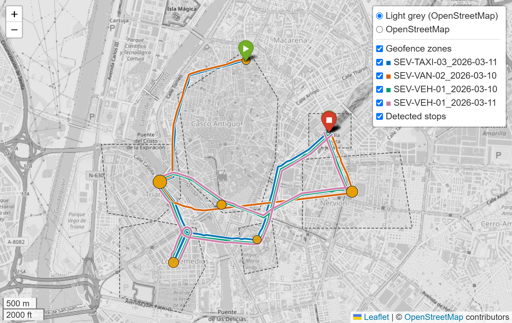
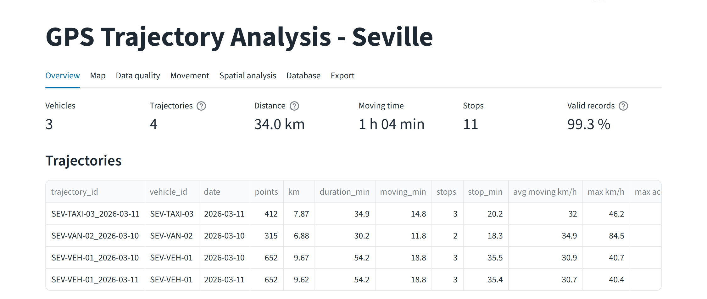
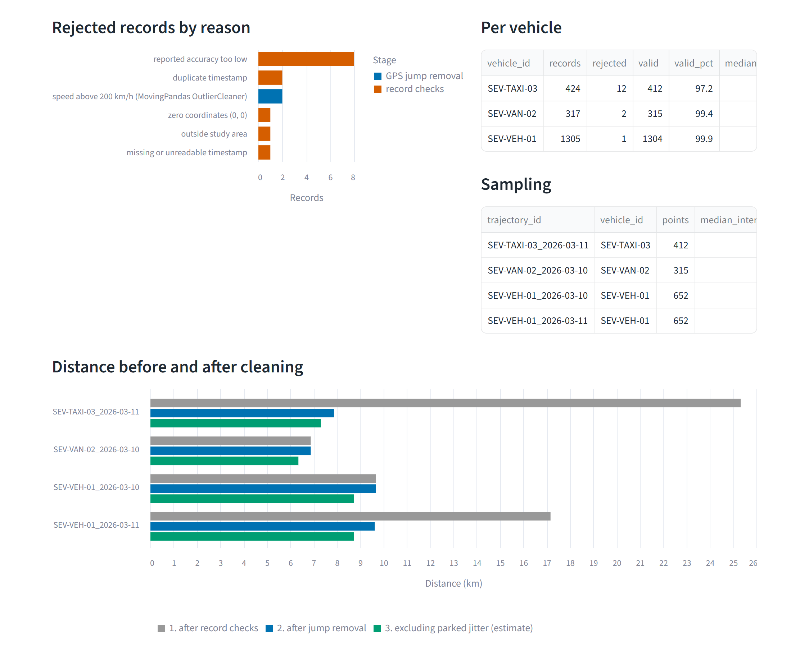
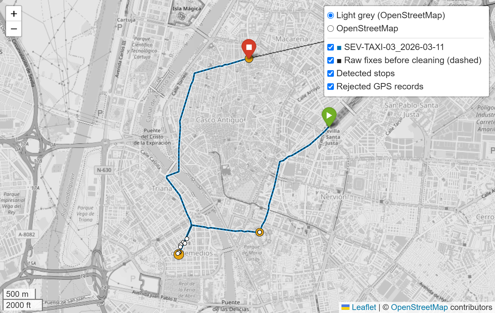
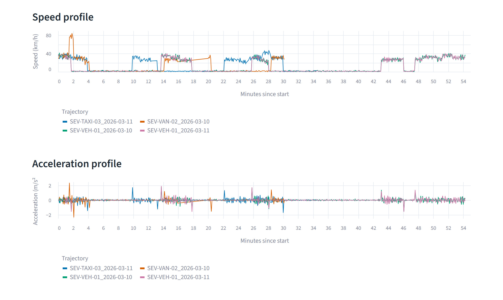
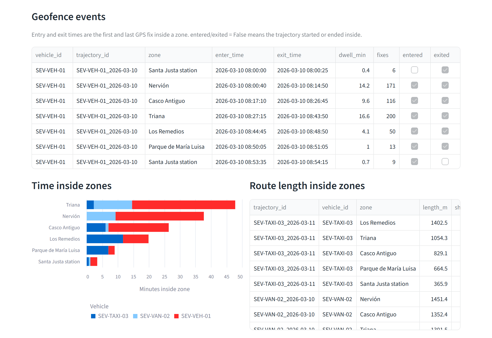
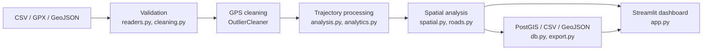

# GPS Trajectory Analysis – Seville

A Streamlit application for cleaning and analysing vehicle GPS tracks. It reads GPS records from CSV, GPX or GeoJSON files, removes invalid records, builds trajectories for several vehicles, and runs trajectory and spatial analysis: stops, journeys, geofencing, proximity and route comparison. Results can be stored in PostGIS and exported as CSV or GeoJSON.

The GPS data is synthetic. It describes three vehicles driving around Seville over two days. Trajectory algorithms come from [MovingPandas](https://github.com/movingpandas/movingpandas), and spatial operations from GeoPandas and Shapely.



## Screenshots

Journey summary for all vehicles:



Data quality: rejected records by reason, and distance at each cleaning stage:



Raw track (dashed) against the cleaned track for one vehicle. The dashed line leaving the top of the map is a GPS jump to the airport. The white circles are fixes rejected for low reported accuracy.



Speed and acceleration profiles:



Geofence events and time spent inside each zone:



## What it does

**Input and cleaning**
- Reads CSV, GPX and GeoJSON (points, or lines with a list of times). Several files can be loaded together.
- Rejects records with a missing or unreadable timestamp or coordinate, coordinates out of range, (0, 0), points outside the study area, a reported accuracy worse than a threshold, or a duplicate timestamp.
- Removes GPS jumps with MovingPandas `OutlierCleaner`.
- All thresholds can be changed in the sidebar or in a TOML file (`config/default.toml`).
- Produces a quality report: records read, valid and rejected, the reason for each rejection, sampling intervals and gaps, and distance at each cleaning stage.
- Keeps raw, cleaned and processed data separate.

**Trajectories**
- Builds one trajectory per vehicle and day.
- Calculates distance, duration, moving time, average and maximum speed, and acceleration.
- Detects stops and dwell times, and splits trajectories into journeys at stops and signal gaps.
- Finds locations visited more than once, by clustering stops with DBSCAN.
- Flags unusual movement: unusually high speed, or harsh acceleration and braking, using a robust z-score per vehicle.
- Compares routes with Hausdorff distance, discrete Fréchet distance, and the share of each route within a buffer around the other.
- Filters by vehicle, date, time of day and zone.

**Spatial analysis**
- Geofencing: entry and exit times and dwell time per zone, from point-in-polygon joins.
- Spatial joins of stops with zones, and the length of each route inside each zone (overlay).
- Route buffers, landmarks near each route, and the nearest landmark to each stop.
- Optional road network from OpenStreetMap with OSMnx, with each fix snapped to the nearest road.
- GeoJSON export of trajectories, stops and zones.

**Storage and dashboard**
- Optional PostGIS storage with spatial indexes, and queries by vehicle, date, bounding box and distance.
- Streamlit dashboard with a layered map (trajectories, stops, zones, rejected points, raw track, buffers, frequent locations, unusual movement, heatmap), charts, tables and download buttons.

## How it works



1. **Read.** Each reader returns the same raw table: `vehicle_id`, `timestamp`, `latitude`, `longitude`, `accuracy_m`, `source`. Values stay as text, so a bad value becomes a rejected record with a reason instead of an error.
2. **Validate.** Record checks with pandas. Each rejected record keeps its original values and the first rule it failed.
3. **Clean.** Records are grouped into one MovingPandas trajectory per vehicle and day. GPS jumps are removed: a jump is a point that would need more than 200 km/h to reach.
4. **Process.** Speed, acceleration, stops and journeys come from MovingPandas. The summary tables, clustering, anomaly rule and route comparison are my code.
5. **Spatial analysis.** Done in WGS84 for storage and display, and in ETRS89 / UTM 30N (EPSG:25830) for anything measured in metres. An automatic UTM zone can be chosen instead.
6. **Output.** Shown in the dashboard, exported as files, or stored in PostGIS.

The code is in `gps_seville/`. `pipeline.py` runs steps 2–4 and returns the raw, cleaned and processed data in one object. `app.py` only builds the interface.

## My code vs. the libraries

| Part | Done by |
|---|---|
| CSV/GPX/GeoJSON readers, column aliases, time zone handling | My code (gpxpy parses GPX) |
| Record checks and rejection reasons | My code, pandas |
| GPS jump removal | MovingPandas `OutlierCleaner` |
| Trajectories, length, speed, acceleration | MovingPandas `TrajectoryCollection`, `add_speed`, `add_acceleration` |
| Stop detection and journey splitting | MovingPandas `TrajectoryStopDetector`, `ObservationGapSplitter`, `StopSplitter` |
| Interpolated position at a given time | MovingPandas `get_position_at` |
| Quality report, distance by cleaning stage, jitter estimate | My code |
| Moving time, average moving speed, summary tables | My code, from MovingPandas results |
| Frequent locations | scikit-learn `DBSCAN`, grouping and summaries are my code |
| Unusual movement (robust z-score) | My code |
| Route similarity | Shapely `hausdorff_distance`, `frechet_distance`; buffer overlap is my code |
| Geofence enter/exit and dwell time | My code, on GeoPandas `sjoin` |
| Route length in zones, buffers, nearest landmark | GeoPandas `overlay`, `buffer`, `sjoin_nearest` |
| CRS handling | pyproj via GeoPandas; choice of CRS and checks are my code |
| Road network and snapping | OSMnx download, GeoPandas `sjoin_nearest` |
| PostGIS schema, storage and queries | My code: SQL with PostGIS functions, SQLAlchemy, GeoAlchemy2 |
| Map and dashboard | My code: Folium, streamlit-folium, Altair, Streamlit |

## Sample data

All data is synthetic, made by `scripts/generate_data.py`:

- `data/vehicle_gps_seville.csv`: the original single-vehicle file (661 records, one trip on 10 March 2026). It is unchanged from the first version of the project.
- `data/fleet_gps_seville.csv`: 2,046 records from three vehicles over two days (10 and 11 March 2026), including the first trip. One vehicle drives the same route on both days. Each record has a reported accuracy in metres.
- `data/samples/`: one track as GPX and one as GeoJSON, for testing uploads.
- `data/zones_seville.geojson`: six zones (Casco Antiguo, Triana, Los Remedios, Nervión, Santa Justa station, Parque de María Luisa).
- `data/poi_seville.geojson`: seven landmarks.

The routes follow waypoints on main streets and bridges, joined by straight lines, so they do not follow the road network exactly. Positions get a random error of a few metres. The zone outlines are drawn by hand and are not official boundaries.

Problems are added on purpose:
- invalid records: missing values, (0, 0), points in Madrid and Cádiz, duplicates
- two GPS jumps per file
- a block of low-accuracy fixes
- a 4-minute signal gap
- one leg driven at about 70 km/h, to test the anomaly detection

## Results with the sample data

With the default settings, the fleet file gives:

- 2,046 records read, 2,031 valid (99.3 %), 15 rejected. The rejections are 8 low-accuracy fixes, 2 duplicates, 2 GPS jumps, 1 zero coordinate, 1 point outside the area and 1 missing timestamp.
- 4 trajectories, 34.0 km, 11 stops and 15 journeys. The van's signal gap splits one of its journeys.
- Frequent locations: Triana and Nervión (3 visits each, 2 vehicles), and Puerta de Jerez (2 visits).
- The same route driven on the two days: Hausdorff 13.8 m, Fréchet 13.9 m, 100 % overlap.
- Unusual speed: 7 fixes from the van at 72–84 km/h, robust z-scores 9.6–12.6. The other flags are acceleration and braking at the start and end of stops, because the synthetic vehicles change speed instantly.

The single-vehicle file gives 652 valid records, 9.7 km and 3 stops, the same as the first version.

To regenerate the data (fixed random seeds, same files each time):

```
.venv\Scripts\python scripts\generate_data.py
```

## GPS accuracy and distance

Consumer GPS positions are typically off by a few metres in the open and by tens of metres near tall buildings or trees. Joining noisy positions with straight lines makes the distance too long. The effect is largest when the vehicle is parked: it does not move, but each new fix lands a metre or two from the last one.

The Data quality tab shows the distance at each stage. In the fleet data, 7–10 % of the cleaned distance is collected while parked; the tab shows this as `stationary_km`. The positions are synthetic, so the results are only as precise as the noise added to them. Distances are shown to the metre only so the stages can be compared.

Positions interpolated between two fixes are estimates. The map shows them as a hollow ring, labelled "interpolated", so they are not confused with GPS observations.

## Setup on Windows

Python 3.11 or newer (tested with Python 3.12 on Windows 11). If `python --version` shows an older version, use the full path to a newer Python in the first command.

```
python -m venv .venv
.venv\Scripts\python -m pip install -r requirements-dev.txt
.venv\Scripts\python -m streamlit run app.py
```

The app opens at http://localhost:8501 with the fleet sample loaded. Settings can also be loaded from a TOML file:

```
.venv\Scripts\python -m streamlit run app.py -- --config config\default.toml
```

**PostGIS (optional).** Needs Docker Desktop.

```
copy .env.example .env
docker compose up -d db
```

Set a password in `.env` before starting the database. The app reads `DATABASE_URL` from `.env`. Without it, the Database tab only shows how to set it up.

**Whole app in Docker:**

```
docker compose up --build
```

**Basemaps.** The map uses OpenStreetMap tiles, shown in light grey by default so the routes stand out. The standard OpenStreetMap style can be selected in the sidebar. CARTO Positron and Voyager also appear if `CARTO_API_KEY` is set in `.env`. CARTO tiles need an API key, and I have not tested them with a real key.

## Tests

```
.venv\Scripts\python -m pytest
.venv\Scripts\python -m ruff check .
.venv\Scripts\python -m ruff format --check .
```

The tests cover:
- the readers, including broken files
- the cleaning rules and configuration
- CRS handling, the pipeline on both sample files, and distances on tracks with a known length
- stop detection, journey splitting, anomalies, clustering, route similarity, filters
- geofencing, spatial joins, buffers and exports
- the map layers and basemaps
- the Streamlit app, run headless with `streamlit.testing`

The PostGIS tests run when `DATABASE_URL` is set. They store and query data, compare PostGIS lengths with the MovingPandas and GeoPandas results, and check that bounding-box queries use the GiST index. A live OpenStreetMap download test runs with `RUN_NETWORK_TESTS=1`.

The GitHub Actions workflow (`.github/workflows/ci.yml`) runs Ruff and the full test suite against a PostGIS service container.

## Project layout

```
app.py                      Streamlit dashboard
gps_seville/
  readers.py                CSV, GPX, GeoJSON input
  cleaning.py               record checks
  pipeline.py               raw -> cleaned -> processed
  analysis.py               MovingPandas trajectories, stops, journeys
  analytics.py              clustering, anomalies, similarity, filters
  quality.py                quality report and distance comparison
  spatial.py                geofencing, joins, buffers, proximity
  roads.py                  OSMnx road network (optional)
  crs.py                    projected CRS selection
  db.py                     PostGIS (optional)
  export.py                 CSV and GeoJSON
  mapping.py, charts.py     Folium map, Altair charts
  views.py                  filtered views for the dashboard
  config.py, env.py, logging_config.py, exceptions.py
config/default.toml         default settings
data/                       sample data, zones, landmarks
scripts/generate_data.py    synthetic data generator
tests/                      pytest tests
docker-compose.yml, Dockerfile, .env.example
```

## Limitations

- The data is synthetic. Routes are straight lines between waypoints, and speed changes at stops are instant.
- One trajectory per vehicle per calendar day. A trip that crosses midnight is split in two.
- Timestamps are treated as local time without a time zone. GPX times in UTC are converted to UTC and the zone is dropped. Files recorded in different time zones are not aligned.
- Geofence entry and exit times are the first and last fix inside a zone, not interpolated boundary crossings (about 5 seconds' accuracy with this data).
- Road snapping assigns each fix to the nearest road. It is not map matching and can pick the wrong street near junctions. Downloading roads for a small area worked in testing. A download for the whole fleet area timed out against the public Overpass server, so that case is not verified.
- The anomaly rule is statistical and per vehicle. It needs at least 10 moving fixes and does not know speed limits.
- The study-area check is a bounding box, not a polygon.
- The map draws routes on the same street side by side with a small screen offset; their coordinates are not changed.
- The GitHub Actions workflow is written but has not run on GitHub yet.

## Possible next steps

- Map matching with a hidden Markov model on the OSM road network.
- Trips that cross midnight, and time zone support.
- Polygon study areas, and zone files with a CRS other than WGS84.
- Testing with real GPS logs.

## Acknowledgements and licences

The libraries are installed from PyPI and not included in this repository.

| Library | Licence |
|---|---|
| [MovingPandas](https://github.com/movingpandas/movingpandas) | BSD 3-Clause |
| [GeoPandas](https://github.com/geopandas/geopandas), [pandas](https://github.com/pandas-dev/pandas), [Shapely](https://github.com/shapely/shapely) | BSD 3-Clause |
| [pyproj](https://github.com/pyproj4/pyproj) | MIT |
| [scikit-learn](https://github.com/scikit-learn/scikit-learn) | BSD 3-Clause |
| [gpxpy](https://github.com/tkrajina/gpxpy) | Apache 2.0 |
| [OSMnx](https://github.com/gboeing/osmnx) | MIT |
| [Folium](https://github.com/python-visualization/folium), [streamlit-folium](https://github.com/randyzwitch/streamlit-folium) | MIT |
| [Streamlit](https://github.com/streamlit/streamlit) | Apache 2.0 |
| [Altair](https://github.com/vega/altair) | BSD 3-Clause |
| [SQLAlchemy](https://github.com/sqlalchemy/sqlalchemy), [GeoAlchemy2](https://github.com/geoalchemy/geoalchemy2) | MIT |
| [psycopg](https://github.com/psycopg/psycopg) | LGPL 3.0 |
| [leaflet-polylineoffset](https://github.com/bbecquet/Leaflet.PolylineOffset) (loaded by Folium from a CDN) | MIT |
| [PostGIS](https://postgis.net/) (Docker image `postgis/postgis`) | GPL 2.0 |

Map tiles and road data © [OpenStreetMap](https://www.openstreetmap.org/copyright) contributors (ODbL).

The first version of the app layout was inspired by [GPX Route Analyzer](https://github.com/imarranz/gpx-route-analyzer) by Ibon Martínez-Arranz (MIT licence). No code was copied from it.

This project is released under the MIT licence, see `LICENSE`.
