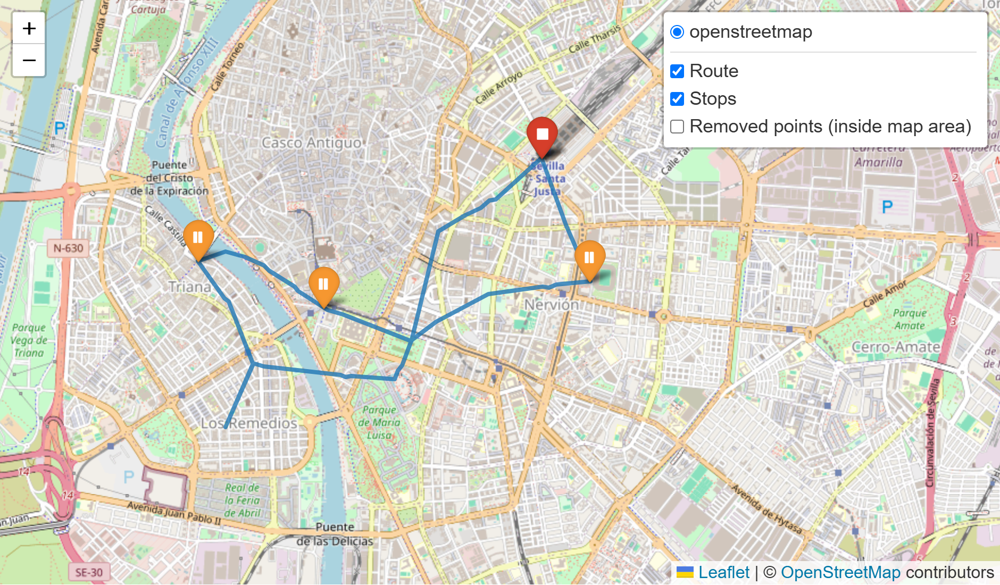
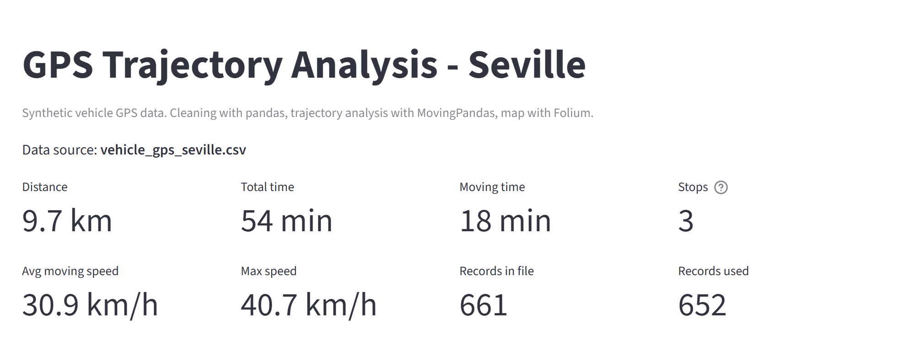
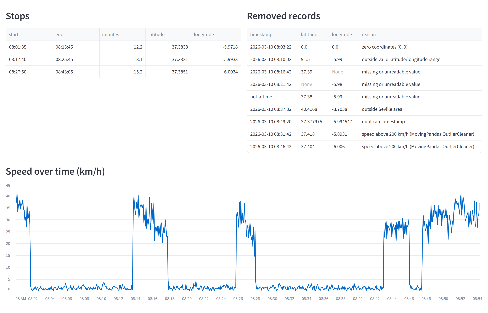

# GPS Trajectory Analysis – Seville

A small Streamlit app that loads GPS records for one vehicle driving around Seville, removes invalid records, analyses the trajectory and shows the result on an interactive map.

The data is synthetic. The trajectory analysis is done with [MovingPandas](https://github.com/movingpandas/movingpandas); this project does not reimplement its algorithms.

## Screenshots

Taken from the running app with the sample dataset and default settings.

Route from Santa Justa through Nervión, the city centre, Triana and Los Remedios, with the three detected stops:



Journey summary:



Stops table, records removed during cleaning, and speed over time:



## Background

My interest in geographic data analysis started during my Computer Engineering studies at the University of Seville. This is an independent personal project that I wrote recently, not university coursework.

## What it does

1. Reads a CSV with `timestamp`, `latitude`, `longitude` (and optionally `vehicle_id`).
2. Removes records that are missing values, have unreadable values, are outside the valid coordinate range, are at (0, 0), are outside a Seville bounding box, or repeat a timestamp.
3. Builds a MovingPandas `Trajectory` and removes GPS jumps with `OutlierCleaner` (points that would need a speed above a set limit to reach).
4. Calculates distance, duration and speed with MovingPandas (`get_length`, `get_duration`, `add_speed`).
5. Detects stops with MovingPandas `TrajectoryStopDetector`.
6. Shows the route, start/end, stops and removed points on a Folium map, plus summary figures, a stops table, a removed-records table and a speed chart. The cleaned trajectory can be downloaded as CSV.

The speed limit for GPS jumps and the stop parameters (maximum diameter, minimum duration) can be changed in the sidebar. You can also upload your own CSV in the same format.

## My implementation vs. the libraries

| Part | Done by |
|---|---|
| Synthetic data generator (`scripts/generate_data.py`) | My code |
| Record checks: missing values, ranges, (0, 0), bounding box, duplicates (`gps_seville/cleaning.py`) | My code, using pandas |
| GPS jump removal | MovingPandas `OutlierCleaner` |
| Distance, duration, speed | MovingPandas `Trajectory` |
| Stop detection | MovingPandas `TrajectoryStopDetector` |
| Summary figures (moving time, average moving speed) | My code, from MovingPandas results |
| Map layers and app layout (`gps_seville/mapping.py`, `app.py`) | My code, using Folium, streamlit-folium and Streamlit |
| Tests (`tests/`) | My code |

## Sample data

`data/vehicle_gps_seville.csv` contains 661 records, one every 5 seconds, for a trip on 10 March 2026 from 08:00 to about 08:54:

Santa Justa station → Nervión (12 min stop) → San Bernardo → Prado de San Sebastián → city centre, Puerta de Jerez (8 min stop) → Paseo de Colón → Puente de Triana → Triana, Plaza del Altozano (15 min stop) → Plaza de Cuba → Los Remedios, Calle Asunción (90 s stop) → Puente de los Remedios → Plaza de España → Avenida Menéndez Pelayo → Santa Justa station

The route is a list of waypoints on main streets and bridges, with straight lines between them. It does not follow the road network exactly, and the coordinates are approximate. Positions have a few metres of random error. Nine invalid records are inserted on purpose: (0, 0), latitude 91.5, a missing longitude, a text value, an unreadable timestamp, a point in Madrid, a duplicate record and two GPS jumps (to the airport and to La Cartuja).

To regenerate the file (same result each time, fixed random seed):

```
.venv\Scripts\python scripts\generate_data.py
```

With the default settings the app reports:

- 9.7 km, 54 min in total, 18 min moving
- 3 stops (Nervión, Puerta de Jerez, Triana). The 90 s stop in Los Remedios is below the 5 min threshold; set the minimum to 1 min and it shows up as a 4th stop.
- 7 records removed by the record checks and 2 removed as GPS jumps

The waypoint route is 8.85 km long. The measured distance is higher because of the random position error, mostly while the vehicle is parked.

## Setup on Windows

Requires Python 3.11 or newer (tested with Python 3.12 on Windows 11). Check with `python --version`. If it shows an older version, use the full path to a newer Python, for example `C:\Users\<you>\AppData\Local\Programs\Python\Python312\python.exe`, in the first command below.

In PowerShell, from the project folder:

```
python -m venv .venv
.venv\Scripts\python -m pip install -r requirements.txt
```

Run the app:

```
.venv\Scripts\python -m streamlit run app.py
```

It opens at http://localhost:8501.

Run the tests:

```
.venv\Scripts\python -m pytest
```

These commands call the virtual environment's Python directly, so you do not need to activate it (activation in PowerShell can be blocked by the execution policy).

## Project layout

```
app.py                       Streamlit app
gps_seville/cleaning.py      CSV loading and record checks
gps_seville/analysis.py      MovingPandas trajectory, outliers, stops, summary
gps_seville/mapping.py       Folium map
scripts/generate_data.py     Synthetic data generator
data/                        Sample CSV
tests/                       pytest tests
```

## Limitations

- One vehicle per file. If the file has several `vehicle_id` values they are treated as one trajectory.
- The bounding box is a rectangle around Seville, so nearby places such as Camas, San Juan de Aznalfarache and the airport are inside it.
- Stops are detected by MovingPandas from position and time only. GPS noise while stopped adds some distance (see above).
- With pandas 3.1, MovingPandas 0.23 prints `Pandas4Warning` deprecation warnings during stop detection. They come from inside MovingPandas and do not affect results.

## Acknowledgements and licences

This project uses the following open-source libraries. They are installed from PyPI and not included in this repository.

| Library | Licence |
|---|---|
| [MovingPandas](https://github.com/movingpandas/movingpandas) (Anita Graser and contributors) | BSD 3-Clause |
| [GeoPandas](https://github.com/geopandas/geopandas) | BSD 3-Clause |
| [pandas](https://github.com/pandas-dev/pandas) | BSD 3-Clause |
| [Shapely](https://github.com/shapely/shapely) | BSD 3-Clause |
| [pyproj](https://github.com/pyproj4/pyproj) | MIT |
| [Folium](https://github.com/python-visualization/folium) | MIT |
| [Streamlit](https://github.com/streamlit/streamlit) | Apache 2.0 |
| [streamlit-folium](https://github.com/randyzwitch/streamlit-folium) | MIT |
| [pytest](https://github.com/pytest-dev/pytest) | MIT |

Map tiles are from [OpenStreetMap](https://www.openstreetmap.org/copyright) (© OpenStreetMap contributors, ODbL).

The app layout (Streamlit + Folium, summary figures, map with start/end and stop markers) was inspired by [GPX Route Analyzer](https://github.com/imarranz/gpx-route-analyzer) by Ibon Martínez-Arranz (MIT licence). No code was copied from it. That project parses GPX files and computes metrics with its own functions; this project reads CSV records and uses MovingPandas for the analysis.

This project is released under the MIT licence, see `LICENSE`.
